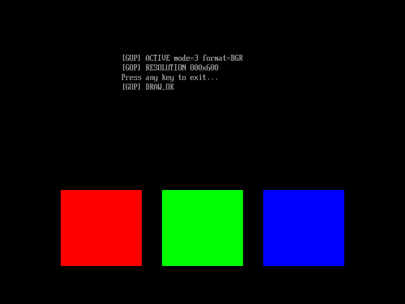

# GOP 第二版：實作、審查與驗收紀錄

[文件索引](../README.md) · 分類：已完成實作

日期：2026-10-12。狀態：實作、自動驗收與使用者人工測試完成。
基準：main，HEAD `6b74ffc8c295dec29ddd09ff0e06c5b2965f80c0`。
使用者授權依 `/tmp/uefi-gop-v2-implementation-plan.md` 開始實作，並使用多個 subagent 審查與驗證。事前文件已保存為 [核定計畫](gop-v2-plan.md)。README / docs 原有整理保留，第一版歷史未改寫。

## 完成行為與任務

取得單一 GOP，在文字輸出前保存原模式純量。依初始 MaxMode 遞增列舉；每輪成功取得的非空 QueryMode 配置，在輸出前嘗試 FreePool 一次。優先沿用原本的 800×600，否則選最小有效目標，找不到時使用原模式。清屏後才切換，重新取得資訊並以 BLT 畫三色塊。

所有取得可靠原模式後的返回路徑通過同一恢復出口。曾嘗試切換、目前偏離原模式或資料無效時，只嘗試恢復一次。主錯誤優先；恢復成功後沒有新的產品 console 輸出，返回 `_start` 後才執行 runtime_fini。

- [x] 任務 1：FreePool / ClearScreen 可呼叫型別、ABI 與假韌體模型。
- [x] 任務 2：逐輪釋放、有效資料檢查、列舉與模式選擇。
- [x] 任務 3：800×600 切換、新資訊驗證與統一恢復。
- [x] 任務 4：主機錯誤矩陣、startup 呼叫契約與 sanitizer。
- [x] 任務 5：獨立 guest probe、分離產物與乾淨 QEMU 驗收。
- [x] 任務 6：知識文件、事前計畫與本次證據保存。

詳細行為及最終狀態政策見 [GOP 文件](../knowledge/gop.md)。startup.cpp、runtime.cpp 與 runtime.hpp 未改動；probe 僅屬測試產物，沒有產品測試開關。

## 本次驗證結果

| 驗證 | 實際結果 | 保存證據 |
|---|---|---|
| make test-host | 114 案例通過，涵蓋正常、所有權、錯誤、恢復與 startup | [host.log](../artifacts/gop-v2/host.log) |
| 嚴格編譯及 sanitizer | -Werror、ASan、UBSan、LeakSanitizer 通過，exit=0 | [sanitizer.log](../artifacts/gop-v2/sanitizer.log) |
| 本機 make test | ABI、PE32+、EFI subsystem、符號、entry / ESP 一致性通過 | [local-build.log](../artifacts/gop-v2/local-build.log) |
| 乾淨正式建置 | 全新來源樹的 make test 通過 | [clean-build.log](../artifacts/gop-v2/clean-build.log) |
| 乾淨 probe 建置 | 另一全新來源樹的 make test-probe 通過 | [clean-probe-build.log](../artifacts/gop-v2/clean-probe-build.log) |
| 正式與 probe QEMU | 實際 800×600、完整 RGB、穩定等待、按鍵返回通過 | [qemu-summary.log](../artifacts/gop-v2/qemu-summary.log) |
| guest 返回前觀測 | 原 mode0 1280×800 BGR → mode3 800×600 BGR → 原 mode0，應用 EFI_SUCCESS | [probe serial](../artifacts/gop-v2/probe-serial.log) |
| 無 VGA | LocateProtocol EFI_NOT_FOUND；不繪圖、不等待，立即返回 | [no-vga serial](../artifacts/gop-v2/no-vga-serial.log) |
| 使用者人工測試 | 使用者確認人工測試皆正常，授權 commit 與 push | 本次對話確認 |
| git diff --check | 通過 | 完成文件後再次執行 |

四份正向／probe 初始與等待 PPM 完全一致，SHA256 `59aaddc8189fda3b1cf56508a1108e95619ed683af0d96080bcd86b5175fba46`。上半部有 3016 個非黑像素；實際視檢四行文字可讀、未裁切，且與下半部色塊分離。下圖是保留的等待畫面，PNG 與原 PPM 的像素相同。



guest probe 在真正應用返回後、runtime_fini 與韌體接手前，獨立重新取得 GOP 並核對原編號、寬高、格式與應用狀態；沒有用韌體選單尺寸判斷恢復。觀測標記：

```text
[PROBE] RESTORE_VERIFIED mode=0 1280x800 format=1 status=0x0000000000000000
```

主機 startup 測試使用 runtime stubs，驗證呼叫契約，不宣稱已執行真正 destructor。FreePool 失敗的配置由 fixture 最後清理；產品只保證已嘗試一次並回報原狀態。

## 三個 subagent 的審查與處理結果

| 角色 | 審查範圍 | 結果 |
|---|---|---|
| host_contract | 所有權、錯誤狀態、恢復分支、startup 次數與順序 | 114 案例與 sanitizer 通過，沒有未解決阻擋問題；[審查紀錄](../artifacts/gop-v2/host-review.md) |
| abi_review | 官方型別、結構 offset、buffer 上限、獨立乾淨建置及 entry / ESP gates | 沒有未解決阻擋問題；最長主摘要含終止字元 113，容量 160；[最終文件與證據審查](../artifacts/gop-v2/document-review.md) |
| qemu_probe | Console / GOP 順序、畫面、guest 觀測獨立性與主機 fixture 同儕審查 | 全部正向／負向驗收通過，沒有未解決阻擋問題 |

已修正或確認：

- 原計畫 FreePool offset 誤寫 64；官方六個前置指標加 24-byte header 得到 **72**，64 是 AllocatePool。ClearScreen 仍為 48。依據：[EDK II UefiSpec.h](https://github.com/tianocore/edk2/blob/master/MdePkg/Include/Uefi/UefiSpec.h)。
- 主機 fixture 的 Hello 缺席條件需先判斷缺席，才尋找事件，已修正。
- 強化 make test / test-probe：真正 PE entry 對應 _start，ESP 與映像相同。QEMU 也拒絕按鍵後的 GOP ERROR。
- 畫面像素檢查另確認文字存在；字形可讀性仍以實際截圖視檢。

驗證工具的負向控制：同一新主機套件對 v1 程式明確失敗；故意省略恢復的測試映像被 probe 拒絕；故意破壞 PE entry 或 ESP 內容也被靜態 gates 拒絕。這些預期失敗不是本版驗收失敗。證據：[v1 拒絕](../artifacts/gop-v2/v1-rejection.log)、[省略恢復拒絕](../artifacts/gop-v2/missing-restore-rejection.log)、[entry 拒絕](../artifacts/gop-v2/entry-rejection.log)、[ESP 拒絕](../artifacts/gop-v2/esp-rejection.log)。

## 證據位置與適用範圍

核心 log、畫面、編譯器／韌體版本及來源雜湊已保存在 [證據目錄](../artifacts/gop-v2/README.md)。完整 QEMU 產物位於 `/tmp/uefi-gop-qemu-r5hwof8v/`，含 PPM、獨立 ESP、VARS 與建置樹；/tmp 可能被清除。

主機完整驗證原記錄位於 `/tmp/uefi-gop-v2-host-verification.md`，獨立靜態檢查位於 `/tmp/uefi-gop-v2-independent-lt9s4o1d/`，省略恢復的負向控制位於 `/tmp/uefi-gop-probe-mutation-n9bidrfh/`。核心部分也已複製到專案，無需依賴 /tmp 才能閱讀本次結果。

QEMU fat:rw 寫入 /var/tmp、LeakSanitizer 的 ptrace 限制，均依工具權限流程允許後重跑成功。實測適用於本次 OVMF 4M 組態；其他韌體的文字配置仍須另行驗證。BLT_ONLY、fallback 等假韌體分支由主機測試驗證，未宣稱本次 QEMU 執行所有像素格式。

本版範圍維持單一 GOP 與 BLT。後續可研究直接 framebuffer、多顯示裝置、OS 載入與 ExitBootServices。
